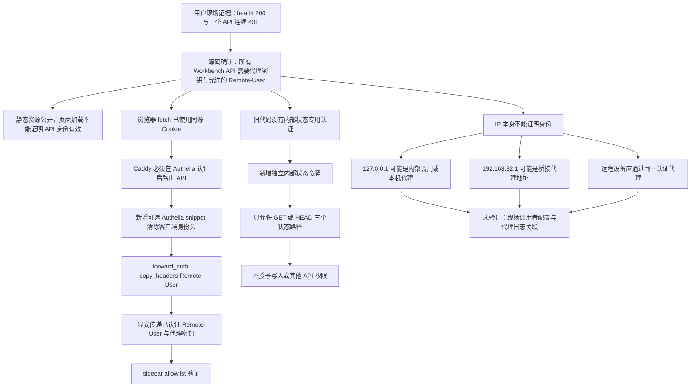
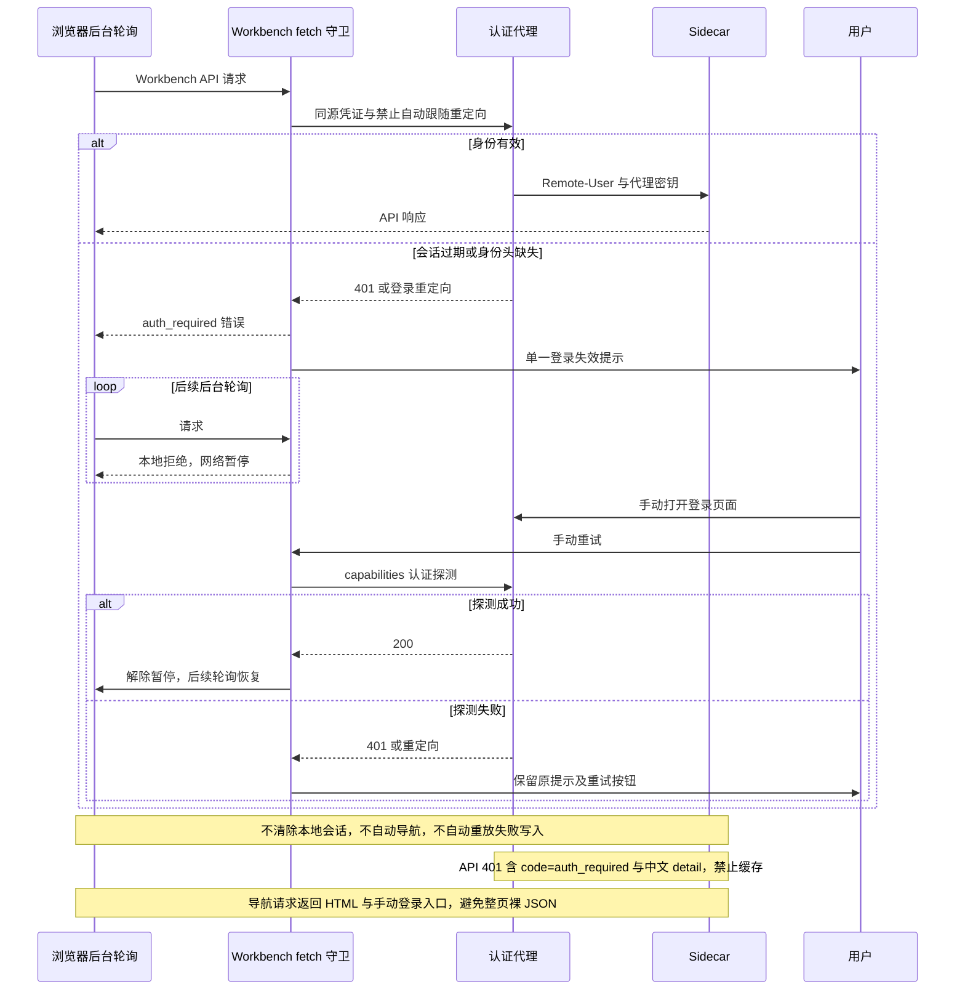
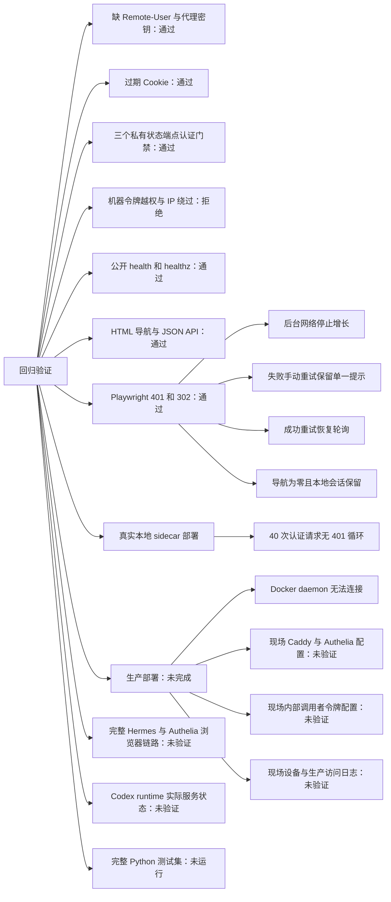

# 认证修复交付记录

结论：代码修复已提交 `18d52f144e44a638901652d02d70425e527d5add`；仅完成隔离环境部署，生产验收未完成。
证据：`artifacts/auth-{typecheck,vitest,python,build,playwright}.log`；类型检查、构建通过，Vitest 602 项、Python sidecar 33 项、Chromium Playwright 2 项通过。
证据：`artifacts/auth-deployment.json`、`artifacts/auth-sidecar-access.log`；本地真实 sidecar 40 次认证轮询全部 200，认证后 401 为 0；3 次主动缺认证负例返回 401，属于预期。
证据：新增日志输出 `workbench_auth_required`、路径、peer、缺失头原因，不记录密钥、令牌或用户身份。

结论：公开状态端点明确为 `/health`、`/healthz`；`/versions`、`/versions/update-status`、`/codex-runtime/status` 保持私有。内部调用使用 `HERMES_WORKBENCH_INTERNAL_STATUS_TOKEN` 和 `X-Workbench-Status-Token`，代理剥离浏览器传入的机器令牌。
风险：必须在实际代理启用认证 snippet 或等效身份映射，并配置真实内部调用者；本次只修改仓库模板，没有改动生产代理或用户其他工作区。

证据：执行 `pnpm typecheck`、`pnpm test`、`env -u CODEX_APP_SERVER_ENDPOINT -u CODEX_HOME .venv/bin/python -m pytest -q tests/test_sidecar_app.py`、`XDG_CONFIG_HOME=$PWD/.isolated-config pnpm build`、`PLAYWRIGHT_BROWSERS_PATH=$PWD/.browsers pnpm exec playwright test --config tests/auth-playwright.config.ts`。
证据：执行 `.venv/bin/python scripts/auth-sidecar-smoke.py`，于 2026-11-05 UTC 启动隔离本地 uvicorn，探测完成后终止；状态文件位于当前工作目录 `test-results/auth-sidecar`，未发布到宿主实例。
风险：Python 测试使用隔离 Python 3.12 环境及最小依赖，未使用部署要求的 Python 3.13 完整锁定依赖；存在 pytest/Starlette 弃用提示。

未验证项：生产 `hermes-workbench-zzl` 部署和连续日志观察未完成；`artifacts/auth-production-access.log` 记录 Docker daemon 无法连接。不能据此声称现场 401 来源已精确定位或生产循环已消失。
未验证项：Playwright 使用真实 Chromium 与受控 API 响应，验证守卫行为；没有运行完整 Hermes/Caddy/Authelia 登录流程。本地 sidecar 未连接 Codex app-server，运行时状态端点只验证认证门禁，未验证实际服务可用性。
