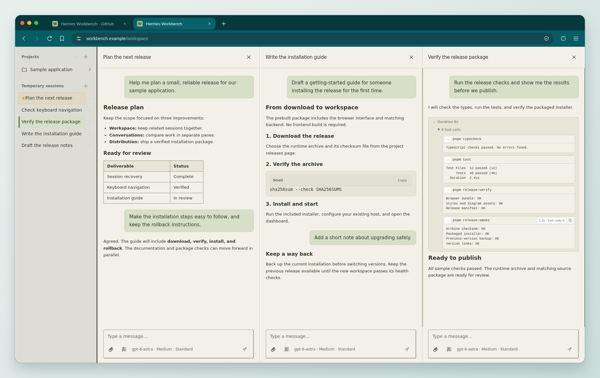
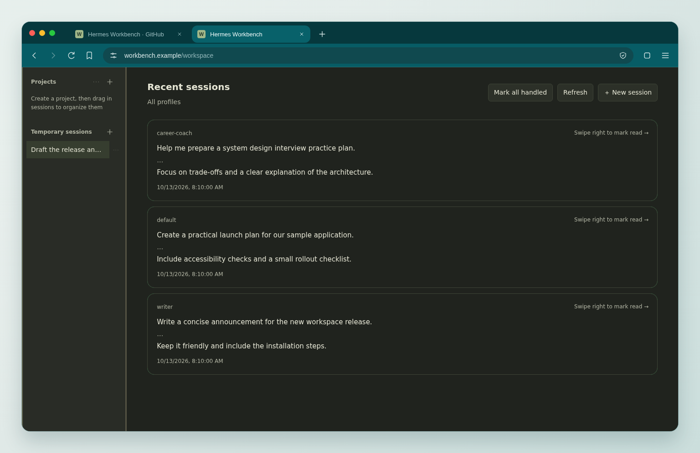
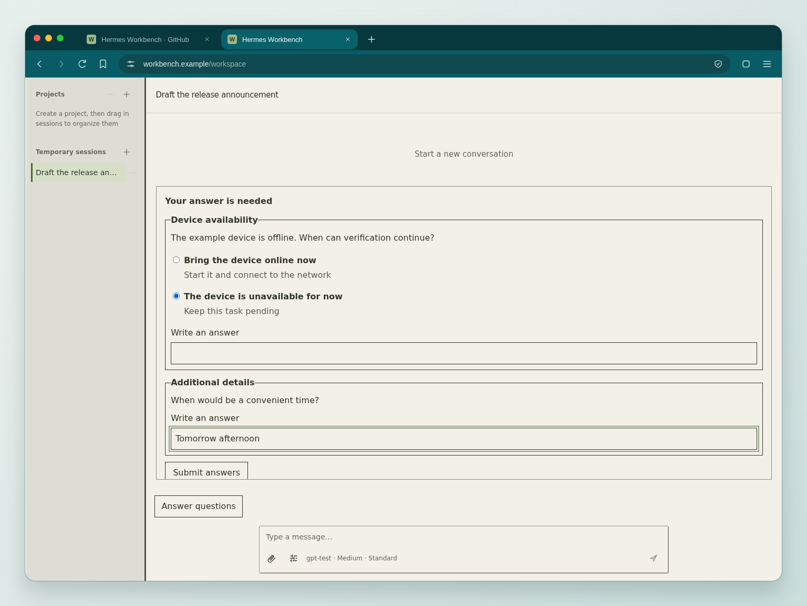
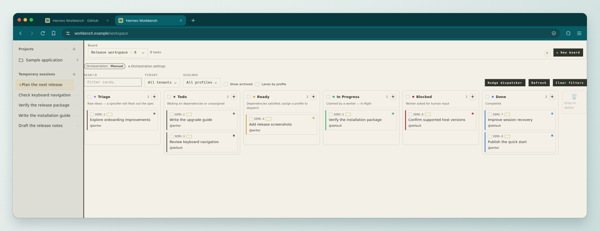
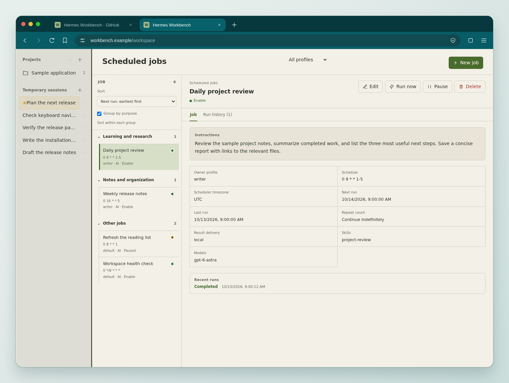
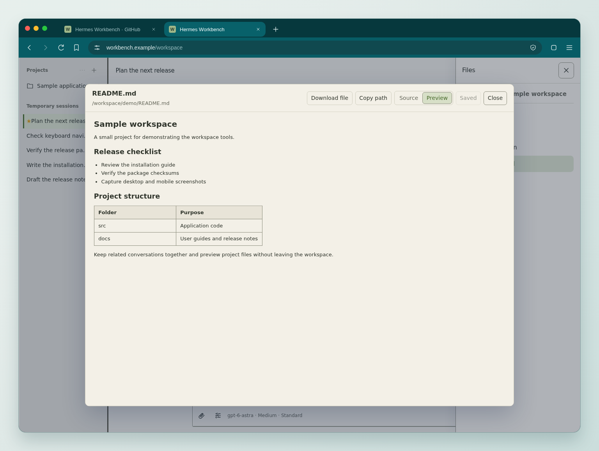
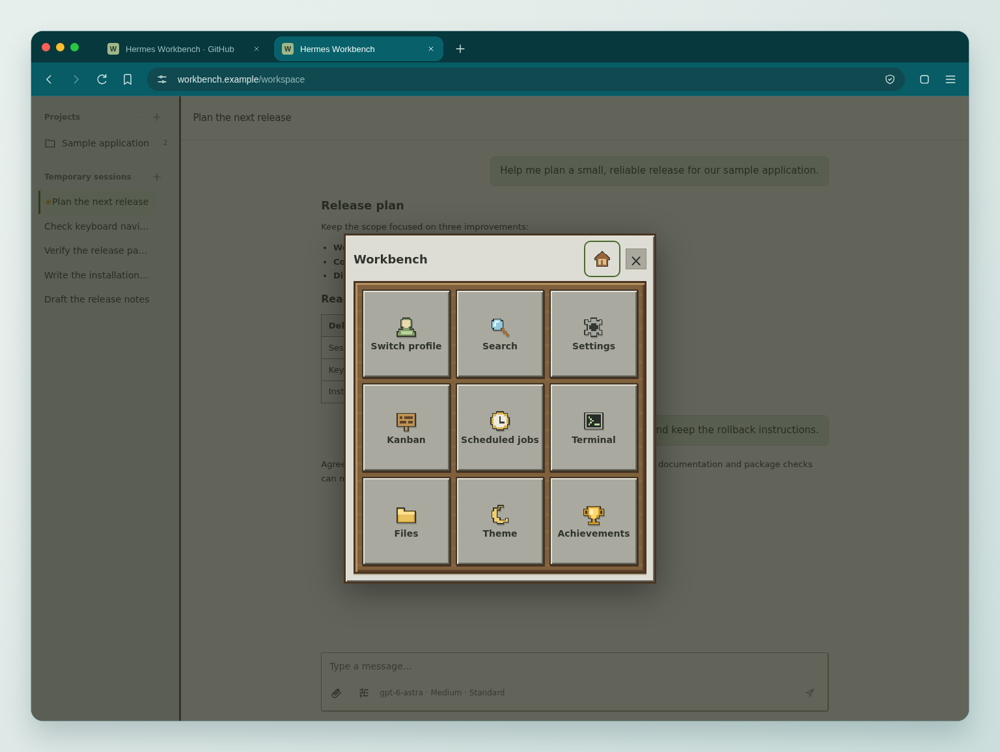
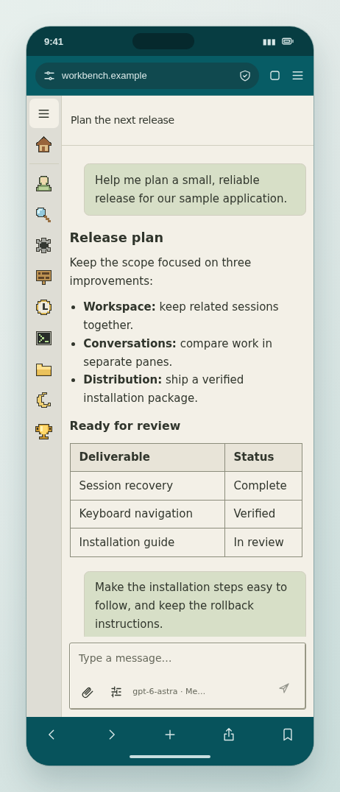

# Hermes Workbench

**Your conversations, projects, and tools in one workspace.**

Hermes Workbench brings side-by-side conversations, project files, kanban boards,
and scheduled jobs to Hermes Agent Dashboard. Keep a plan open while an agent
writes the guide and another checks the results.

[Get started](docs/installation.md#quick-start-existing-hermes-host) ·
[Download a release](https://github.com/DeeliN221/hermes-workbench/releases) ·
[Developer guide](dev.md)

## Keep related work together

Each conversation pane has its own history and composer. Group sessions by
project, switch profiles, and inspect tool output alongside the work it supports.
The home page brings recent activity across profiles into view; agent questions
can be answered directly in the conversation.

| Pick up where you left off | Answer without leaving the conversation |
| --- | --- |
|  |  |

## From a task to its files

Track work on a kanban board, review recurring jobs, and open workspace files
without leaving Workbench.

### Kanban

See tasks by stage and assigned profile, and filter the board to find the work
you need. This view integrates the Hermes Kanban plugin.

### Scheduled jobs

Review recurring tasks across profiles, read their instructions and schedules,
and check recent runs from the same page.

### Files and diagrams

Read formatted Markdown, switch to source, or download a file from the preview.
Mermaid and PlantUML diagrams render in chat and file previews; UML files can
also be opened directly.

## At your desk or on your phone

Press **W** on desktop to open the Minecraft-inspired Workbench menu, with
access to tools including files, skills, and the terminal. On a phone, the compact
action rail keeps profiles, search, kanban, scheduled jobs, files, and theme
controls beside the conversation.

<table>
  <tr><th>Desktop · Workbench menu</th><th>Mobile · Quick actions</th></tr>
  <tr>
    <td></td>
    <td></td>
  </tr>
</table>

English is the default interface language. The included Simplified Chinese pack
follows the Dashboard's explicit language selection.

*Images show actual Workbench layouts with fictional English data and mocked API
responses. Browser frames are decorative Brave/Chrome style presentations.
No private conversations or credentials are shown. Click an image for full size.*

## Get started

Workbench is an extension for Hermes Agent Dashboard. Download a prebuilt archive
and `SHA256SUMS` from [Releases](https://github.com/DeeliN221/hermes-workbench/releases),
then follow the [installation guide](docs/installation.md#quick-start-existing-hermes-host).
Prebuilt releases include the installer and require no Node.js, pnpm, or frontend build.

The [installation guide](docs/installation.md) also covers upgrades and rollback.
For source setup, tests, contributions, and releases, see the [developer guide](dev.md).

Licensed under [AGPL-3.0-only](LICENSE). See [third-party notices](THIRD_PARTY_NOTICES.md).
