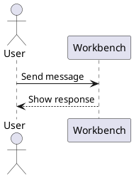

[← Back to README](README.md)

# Development

Requirements: Node.js 22.12+, the pnpm version declared in package.json, and Python 3.13 / uv.
Mermaid diagrams require an ES2024-capable browser (Safari 17.4+ or a current Chrome/Firefox).

```sh
pnpm install --frozen-lockfile
pnpm version:check
pnpm typecheck
pnpm test
pnpm test:python
pnpm build
pnpm release:verify
pnpm release:package
```

Browser source lives in `dashboard/src/`; `dashboard/dist/` contains generated assets.
Python test dependencies are pinned in `requirements-dev.txt`. To update them:
`uv pip compile requirements-dev.in -o requirements-dev.txt`.

Optional Hermes-side compatibility changes are maintained with their tests in
[`integrations/hermes`](integrations/hermes/README.md). The layer is pinned to
an explicit upstream revision and is applied separately from the plugin.

## Contributions and releases

Use pull requests against `main` and pass CI before releasing.
See [releases](docs/releases.md) and [managed releases](docs/managed-releases.md)
for versioning, isolated instances, manual updates, and rollback.
Deployment templates are in `deploy/`. Copy `.env.example` and supply your own
image, paths, and authentication settings; templates include no runtime image,
identity provider, or credentials.
For a source-checkout browser test, follow the [local test environment](deploy/README.md#local-test-environment)
steps; the Workbench tab is served at `/workbench` through the local proxy.

The repository starts from a reviewed source snapshot. Clone it afresh rather
than merging old repository history. Existing private recovery copies remain
separate from this public project.

### UML diagrams

Markdown chat and file previews render `plantuml`, `puml`, and `uml` fences
with the bundled PlantUML browser engine. The engine is loaded lazily from
`dashboard/vendor/plantuml/runtime.js` only when a diagram is present, so the
diagram source stays in the browser and no rendering server is required.
Remote `!include` and `!import` directives are rejected because the browser
engine cannot safely resolve them; inline the definitions instead. Source is
limited to 100,000 characters. The generated SVG uses the browser's sans-serif
fallback, so CJK labels render with the system CJK font without bundling one.
The browser build does not include the `@startdot`, `@startditaa`, or
`@startsalt` extensions.
`.puml`, `.plantuml`, and `.uml` files also open as diagrams.

````markdown

````

Source viewing and copying remain available, including after a rendering error.
Local rendering currently rejects `!include` and `!import`; inline those definitions.
Mermaid fences continue to use Mermaid syntax and the existing renderer.

## README showcase images

Original interface captures live in `assets/screenshots/`. They use fictional
English conversations and mocked local API responses. The README uses
`assets/showcase/`, rendered with decorative Brave/Chrome style
browser frames: a dark teal tab strip and address bar on desktop, with matching
mobile controls. The frames do not indicate testing on physical devices.

To regenerate the images with an isolated Playwright installation:

```sh
npm install --prefix /tmp/workbench-readme-render playwright
/tmp/workbench-readme-render/node_modules/.bin/playwright install chromium
NODE_PATH=/tmp/workbench-readme-render/node_modules node scripts/render-readme.cjs
```

The renderer preserves each original capture at its native resolution and adds
the browser controls, rounded corners, shadow, and background with HTML/CSS.
The address `workbench.example` is illustrative. To use an existing Chromium
binary, set `CHROMIUM_EXECUTABLE_PATH` when running the script.
# Pull request body check

GitHub PRs must pass the repository contract before publication. Save the
proposed body to a file and run:

```sh
pnpm pr:check /tmp/pr-body.md
```

The checker requires English text and the `Behavior`, `Scope`, and `Validation`
sections. It does not require an image. Frontend changes should include relevant
before and after screenshots under an optional `Visuals` section; backend-only
changes can omit it. The checker rejects test-count waterfalls and similar
execution logs.

