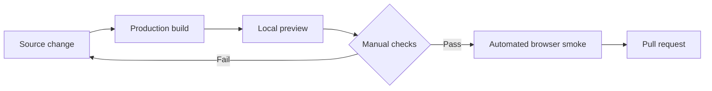

# Local preview and release gate

The local preview is an isolated pre-release environment for checking the built
Workbench interface before creating a pull request or updating a production host.
It uses a real Chromium browser, the real React runtime, and the exact built
`dashboard/dist/index.js`. Hermes responses are deterministic local fixtures.



## Safety boundary

The preview binds to `127.0.0.1` by default and does not connect to the NAS,
production databases, workspace files, Hermes authentication, or Codex. All
session and file responses come from `tests/browser/mock-host.mjs`. It is a UI and
plugin-boundary test environment; it does not replace final backend integration
testing against an isolated Hermes runtime.

## Use

Install once:

```sh
pnpm install --frozen-lockfile
pnpm exec playwright install chromium
```

Build the current source and start the preview:

```sh
pnpm preview:local
```

Open <http://127.0.0.1:9130/sessions?profile=default>. The bottom-left banner
identifies the fixture and links to the home page and sample chat routes. Browser
errors appear in a visible panel instead of only failing in the console.

The manual checks should cover the behavior changed by the branch and the shared
entry paths: home cards, opening a Codex or Hermes conversation, switching between
the `default` and `writer` fixtures, refresh/reload, and responsive layout. The
fixtures intentionally contain both chat sources and both profiles.

Run the same host automatically without a visible browser:

```sh
pnpm test:browser
```

The command fails on uncaught browser errors. Both `pnpm build && pnpm test:browser`
and the preview command are documented in the development setup.
