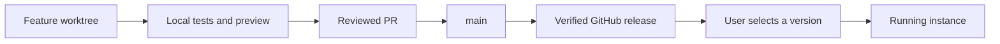

# Development and managed instances

## Development and manual activation

For an everyday installation, set `"mode": "manual-release"` in its local
policy (alongside the existing absolute `source` and `target` paths).
`source` identifies the main checkout of one Git repository. Create feature branches
with `git worktree add`; linked worktrees may build and test locally, while unrelated
clones and recovery copies are rejected when this policy is present. Builds in the
main checkout are also rejected, keeping the everyday service source untouched.



Building, merging a PR, and publishing a release do not activate it. In
`manual-release` mode, both `npm run deploy:dev` and the direct development
publisher exit before building or writing installed assets. Use Settings → Version
switching to explicitly install a published version. Keep the existing runtime
unchanged while preparing a first managed migration; changing the policy alone
does not convert an old development service into a full managed installation.

Store the policy outside the repository at
`$XDG_CONFIG_HOME/hermes-workbench/development.json` (default:
`~/.config/hermes-workbench/development.json`), or select it with
`HERMES_WORKBENCH_DEV_POLICY`. Missing explicit policies and unknown modes fail
closed. `deploy:dev` always requires a policy.

Dedicated disposable development instances may keep `"mode": "development"`
(the backward-compatible default) and use `npm run deploy:dev` from their configured
source. Do not point such a policy at an everyday or managed instance. Backend
changes in an everyday installation must travel with its selected full release,
not a restart against a feature branch.

## Managed instance

Do not mount development source. Keep user data, workspace, and credentials isolated
from development. `WORKBENCH_RELEASE_HOME=/opt/data/workbench` enables full updates:

```text
/opt/data/workbench/
  bootstrap/             administrator-installed supervisor
  releases/<version>/    verified, read-only release
    plugin/dashboard/    loader, browser assets, manifest
    sidecar/dashboard/   matching backend and build assets
    release.json         version, commit, runtime_abi
    release-files.json   archive file hashes
  current -> releases/<version>
  update.json            recoverable update state
/opt/data/plugins/dist/workbench/dashboard -> /opt/data/workbench/current/plugin/dashboard
```

Settings → Version switching lists GitHub releases and logs. Downloads start only
on user request. The updater verifies SHA256SUMS, version, file hashes, and runtime
ABI; it rejects path traversal, link members, and oversized archives. Switching
is blocked while Codex tasks or terminal connections are active. The supervisor
restarts only the Workbench API, leaving Hermes and Codex App Server running.

One atomic version pointer selects matching browser and backend files. Success
requires the backend's healthy version to match. Failed startup restores the old
pointer and backend; an interrupted update also recovers the previous version on
startup. The UI polls through brief disconnections and resumes status tracking
after refresh. Previous full releases remain available for rollback. Legacy
interface-only caches are not full-version rollback targets.

`runtime_abi=1` describes the supported Python environment and supervisor protocol.
Breaking base dependencies or supervisor compatibility requires an ABI bump and an
administrator-managed environment update. A frontend package must not silently
install system dependencies, update Hermes, or restart an entire container.

## First-time managed migration

1. Wait for tasks to finish and disable `sessions.auto_prune` in affected Hermes
   profiles. Back up databases, settings, credentials, session transcripts, raw
   requests, Compose configuration, and the installed plugin directory.
2. Download a full GitHub release and SHA256SUMS; verify origin and hashes.
3. Stop the managed instance's Workbench. Run `scripts/install-managed-release.py`
   with `--archive`, `--sha256`, `--version`, `--uid`, and `--gid`. The first install
   preserves the original dashboard backup.
4. Start Workbench with `bootstrap/combined_runtime.py` and set
   `WORKBENCH_RELEASE_HOME`. Remove development-source mounts from that managed
   Workbench and Hermes instance.
5. Recreate only services whose mounts changed. Verify image, identity, data
   mounts, healthy version, plugin links, asset hashes, database records,
   transcripts, and the authenticated Dashboard route. Restore saved configuration
   and plugin assets if validation fails.

GitHub Actions publishes releases without accessing deployment hosts or installing
updates. Host-specific paths, identities, and operational commands stay outside the
public repository. Publishing and user installation are separate steps.
