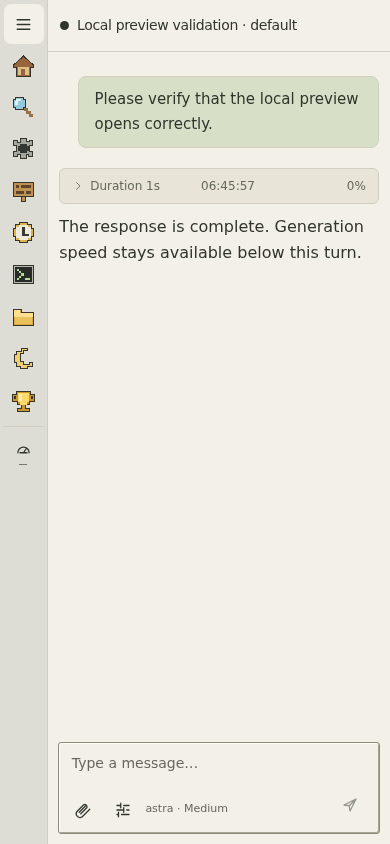
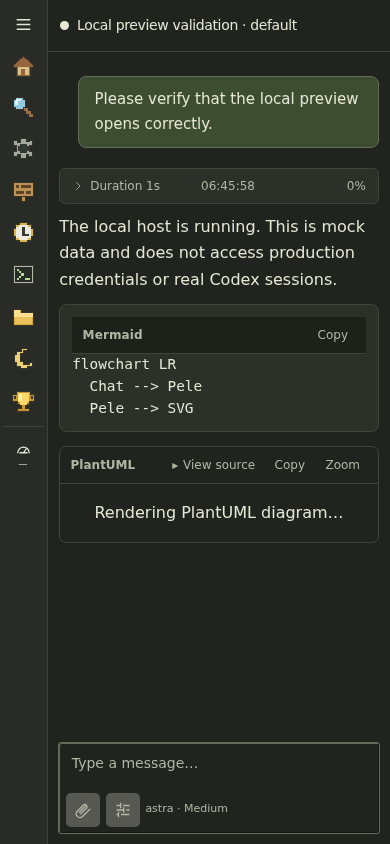
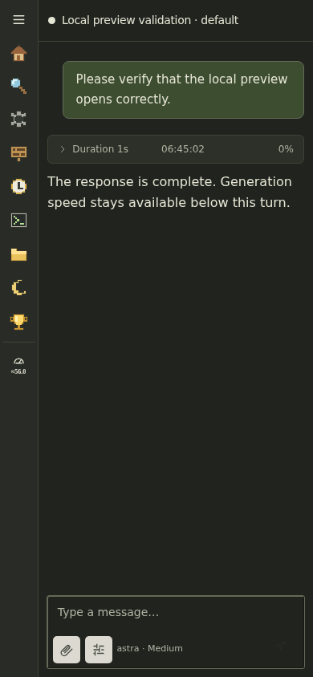

# Generation speed regression evidence

These are actual localhost browser screenshots using deterministic, synthetic
conversation data. The before screenshots use the previous production collector
contract, which never provides a rate. The after screenshots use metrics computed
by the production Python collector, including a tool pause, and show an estimated
56.0 tokens per second. No personal conversations are included.

| Theme | Before | After |
| --- | --- | --- |
| Light |  |  |
| Dark |  |  |
