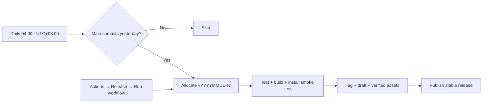

# Versioning and releases

Releases use `v20261015-1`, `v20261015-2`, and so on. The date is the release
run's date in **UTC+08:00**; the positive counter restarts each day and is
one greater than every existing tag or draft for that date. Numeric ordering
places `-10` after `-9`. Legacy SemVer and unprefixed date releases remain
installable.

## Automatic and manual publishing

- **Daily:** the Release workflow is scheduled at 04:00 UTC+08:00
  (`0 20 * * *` UTC), three hours before the intended 07:00 publication, to
  absorb GitHub's typical schedule delay. It publishes only if main's
  first-parent history has a commit in the previous UTC+08:00 calendar day,
  from 00:00 inclusive to the next 00:00 exclusive.
  Changes merged after midnight are included in the current main snapshot if
  yesterday also had changes. Unmerged branch changes do not count.
- **Manual:** open **Actions → Release → Run workflow**, select **main**, and run.
  Each invocation publishes another version, even when source files have not
  changed. Other branches are rejected. No version input or manual tag is needed.
  Select the optional **dry_run** checkbox to exercise validation and packaging
  without creating a tag, reserving a counter, or publishing anything.
- **Concurrency:** scheduled and manual releases share one concurrency group
  across allocation, validation and publication, preventing number collisions.
  Existing tags and releases are never overwritten. Failed runs can be retried
  manually; a reserved tag or draft consumes its counter, so gaps are possible.

Release notes compare the new tag with the newest published stable release.
Drafts and prereleases are skipped; the first release starts at the repository
root. The notes list merged Pull Request titles, not commits inside each PR.

GitHub schedules can start late or be dropped during high load; 04:00 is the
requested trigger time, not a guaranteed publication time. The three-hour
offset is intentional: observed delays have been 1.5–3 hours. See
[GitHub's schedule documentation](https://docs.github.com/en/actions/reference/workflows-and-actions/events-that-trigger-workflows#schedule).
A missed day's release can be triggered manually.

## Version and artifact integrity

`package.json` and `dashboard/manifest.json` contain the same `YYYYMMDD-N`
version; the frontend imports the package version. The workflow stamps them in
an isolated release commit based on the checked-out main snapshot. Only the
release tag points to this commit: main is not changed by the release bot, so
publishing cannot create a daily version-bump loop. The old Prepare release
workflow and push-triggered SemVer publishing are retired.

The exact candidate runs type checks, frontend and Python tests, build, privacy
and history checks, packaging, and the packaged installer smoke test. Only then
is its tag pushed. Archives use `hermes-workbench-vYYYYMMDD-N` and ship together
with matching source and `SHA256SUMS`. `release.json` records both the release
commit and its main `source_commit`. The draft becomes public only after all
uploads succeed; date counters are stable releases, not SemVer prereleases.

CI never connects to deployment hosts or restarts services. Protect main against
force pushes and deletion, require the CI gate, and review changes through PRs.
Publishing uses the short-lived `GITHUB_TOKEN`; no extra secret is required.

## Manual user updates

Managed instances switch the matching frontend and backend together and roll back
on health-check failure. Development instances retain source-based development;
browser publishing only updates the developer instance's assets. First-time managed
setup requires an administrator migration. A legacy interface-only updater does not
silently become a full updater. See [managed releases](managed-releases.md).
Publishing a GitHub Release does not deploy to a host or update user instances.
