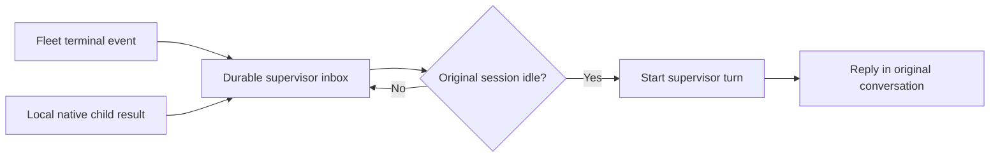

# Supervisor callbacks

The Codex sidecar keeps collecting task outcomes after a chat turn finishes or
the browser disconnects. An idle originating conversation receives a new model
turn asking its supervisor to review the result and report it to the user.

Fleet tasks created by a compatible CLI carry `source_thread_id` and
`source_runtime` in their spec. The CLI reads `CODEX_THREAD_ID`; an explicit
`--source-thread` overrides it, and an empty value disables the binding. A full
Fleet `origin` is also supported when its user, profile, session and workspace
match a local Codex session. Unbound, ambiguous and other-runtime tasks are not
sent to an arbitrary conversation. Successful native mirror cards do not cause a
second callback; the native child result is the notification source.

The sidecar uses the existing server-only Fleet URL and credentials. Its event
cursor advances only after the inbox is durable. The native adapter reads the
local Codex child index and requests each child's latest turn through the existing
RPC connection. Neither collector needs an open browser. Separate background
loops prevent an unavailable source from stopping inbox delivery.

The inbox serializes sends with user submissions, waits for active turns and
approvals, and uses a stable request ID across restarts. A timed-out send is
reconciled against native history, never blindly resubmitted. Rejected, unknown
and unavailable deliveries retain their state and error in `supervisor_inbox`.
Normal assistant replies use the existing history, unread and event mechanisms.

This change covers the Codex sidecar, not standalone DSH or native Hermes.
Local native detection requires a local runtime endpoint and `CODEX_HOME` with
the supported child-index schema. First activation establishes watermarks and
does not replay historical tasks. A compatible Fleet CLI is required for new CLI
tasks to bind their originating thread. Shipping source code does not activate a
running release; the existing manual version-switch policy still applies.
