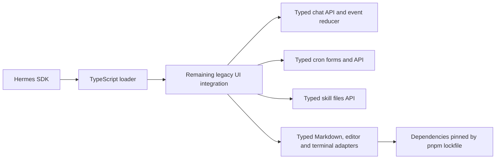

# TypeScript application boundaries

Maintained dashboard modules use strict TypeScript. Incoming API data is `unknown`
until it is normalized; commands, forms, messages, and response metadata have explicit
contracts. No migrated module disables checking or uses `any` to stand in for its model.

The recovered runtime decreased from 61,960 lines / 2,320,583 bytes to approximately
15,000 lines / 517 KB in this migration. Most removed code was embedded micromark,
CodeMirror, and xterm distributions, now imported from their declared packages.
This is dependency deduplication, not a claim that all those lines were rewritten
in TypeScript. The duplicate locale installer was removed in favor of the canonical
TypeScript implementation.

Typed modules now own:

- Session, group, goal, model, attachment, approval, and message command APIs.
- Native message normalization, incremental event reconciliation, and error handling.
- Cron forms, payloads, history ordering, and native/extended endpoint selection.
- Skill file listing, previews, uploads, mutations, and versioned writes.
- Markdown parsing, syntax-language selection, highlighting, and terminal construction.
- The stable sidecar loader, alongside existing setup, summaries, and locale modules.

`pnpm typecheck` checks these modules and rejects new dashboard JavaScript files or
`@ts-nocheck` directives. The loader is built separately into
`dashboard/dist/loader.js`; release packaging and provenance use that generated
artifact. Installed browser paths remain unchanged.

The remaining `dashboard/src/recovered-runtime.js` contains legacy UI components
and host integration. It remains visible as JavaScript in language statistics and
should be extracted feature by feature with interaction tests. PlantUML vendor
files retain their upstream format and licenses; browser builds necessarily emit
JavaScript. The optional README screenshot utility still uses CommonJS with its
external Playwright installation.
