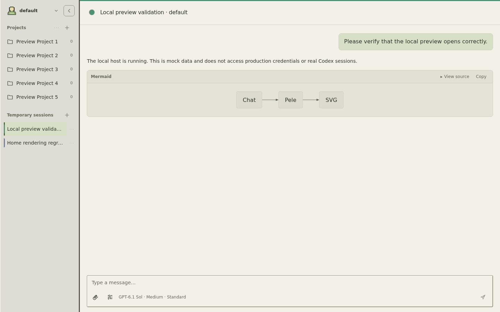
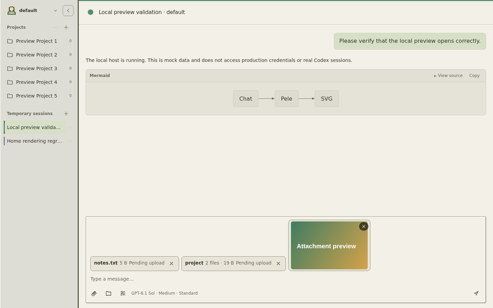
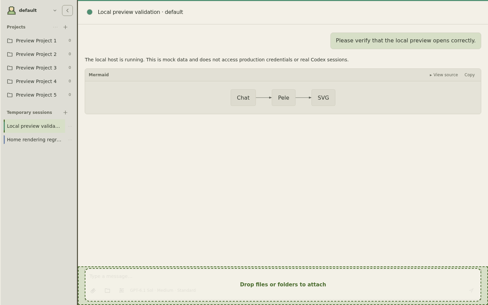
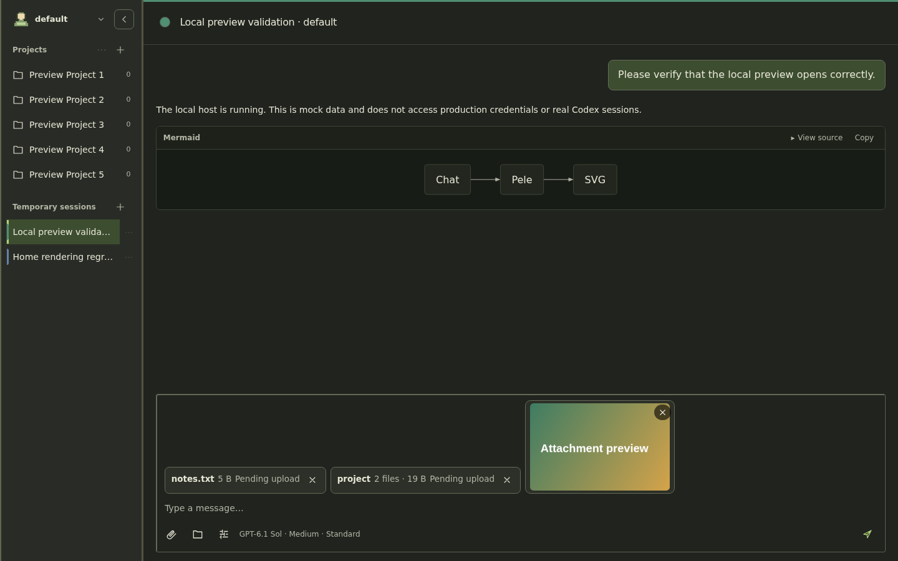
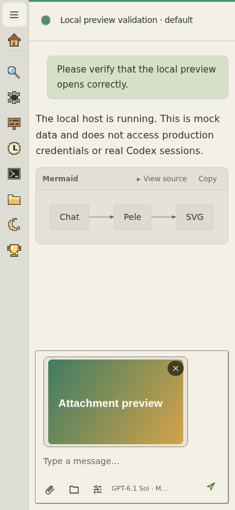
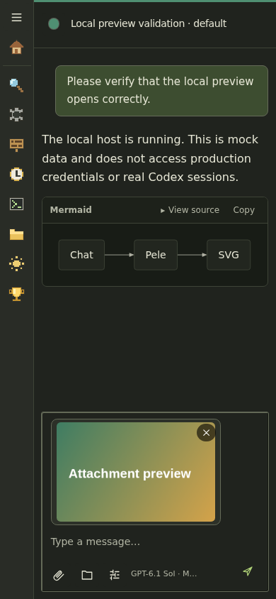
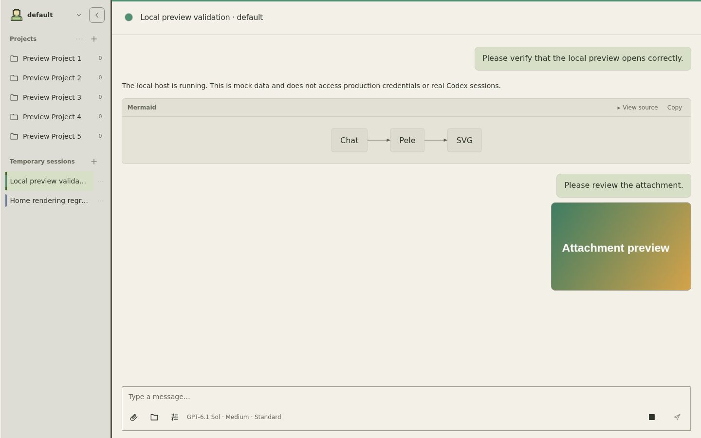

# Attachment drag-and-drop validation

These screenshots use the built `dashboard/dist/index.js` in Chromium through the
local fixture host (`pnpm preview:local`). All visible conversation and file
content is fictional preview data; no production or NAS state is read.

Covered in the same build:

- Dragging a file over the composer shows the drop target and queues the file.
- Dropping loose files and adding a folder both create attachment chips; the
  folder chip reports its file count and total size.
- Image attachments show an aspect-preserving preview in the composer and again
  below the sent user message. Image previews do not display filenames; the model
  still receives only the stored file path.
- The folder picker uses `webkitdirectory`, and the upload posts one manifest so
  the folder tree is preserved on the server.
- Every attachment is delivered to the agent as a path with an on-demand reading
  note, so a large file or folder never has to be loaded into the context window.
- Light and dark desktop layouts at 1440 × 900, plus the light and dark mobile
  composer at 390 × 844.

The queued chips are shown before sending. Uploading starts when the message is
submitted, matching the existing attachment lifecycle.

| Before | After |
| --- | --- |
|  |  |

| Desktop drop target | Desktop dark |
| --- | --- |
|  |  |

| Mobile light | Mobile dark |
| --- | --- |
|  |  |

| Sent message with thumbnail |
| --- |
|  |
