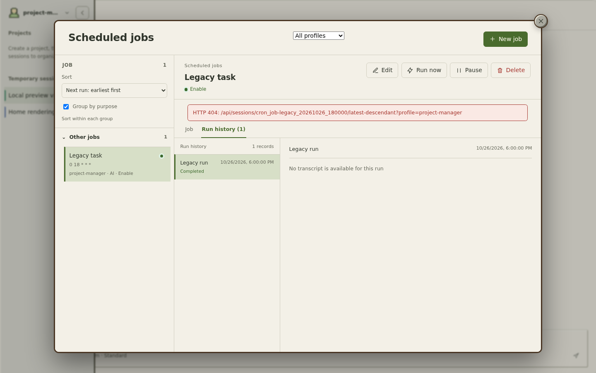
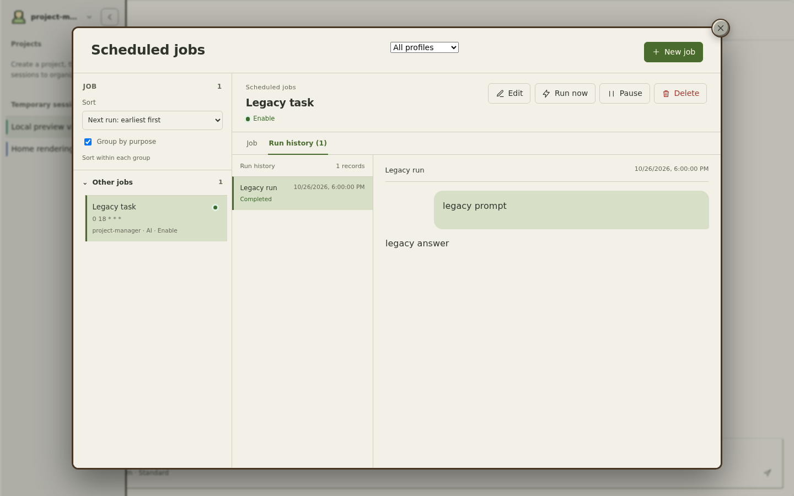

# Cron session fallback validation

These screenshots use the English interface and fictional task content in a local
Chromium fixture at 1440 × 900. The task belongs to `project-manager`; its run
session exists, while the legacy `latest-descendant` fixture returns 404 because
that endpoint reads the default profile.

Before the fix, the missing descendant response surfaced as a red inline error.
After the fix, the run session loads directly from its owning profile and renders
the transcript. This is localhost UI validation with mocked API responses, not a
production-browser check.

| Before | After |
| --- | --- |
|  |  |
