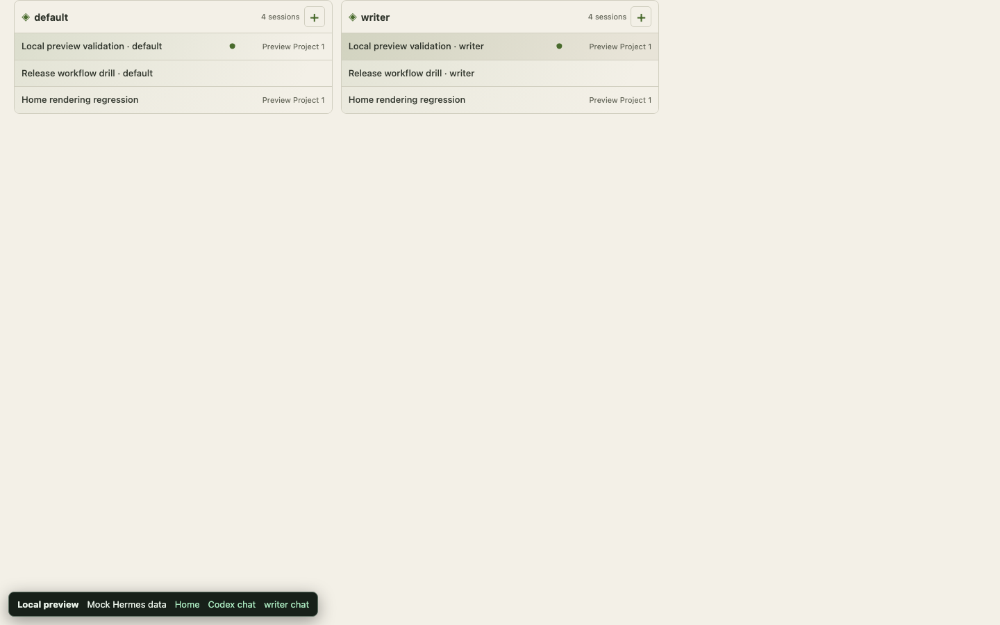
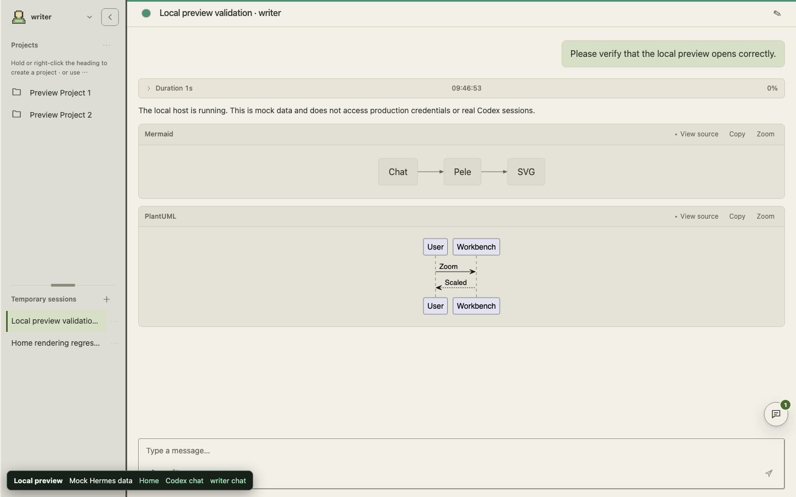
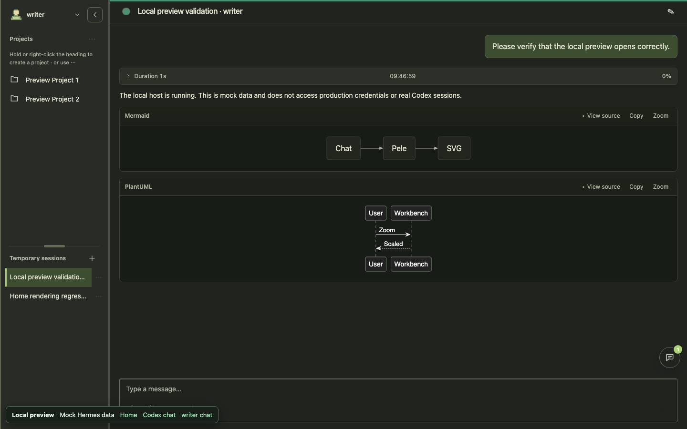
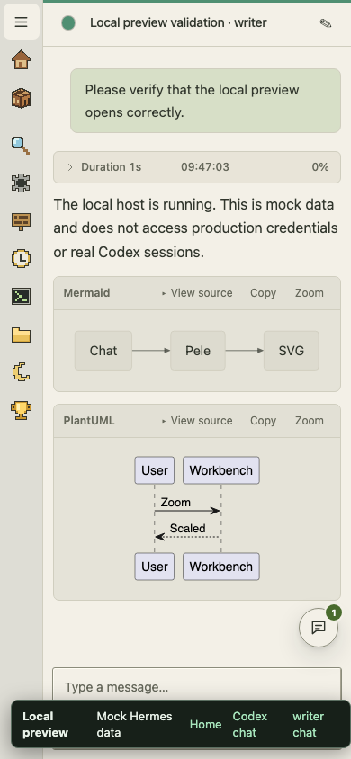
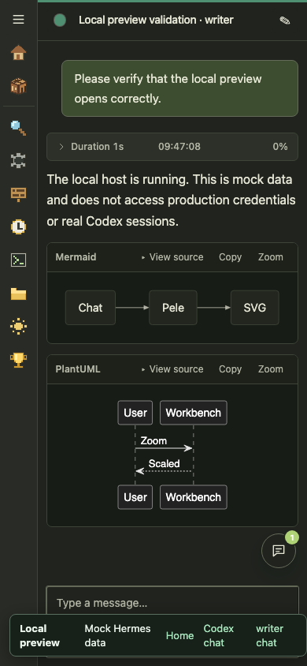

# First-click session navigation

The first home-card click now opens the selected conversation in one navigation.
The previous cross-profile path switched the profile on `/` first, then waited
two animation frames before navigating to `/chat`. Hermes' profile synchronization
and fallback redirect could commit afterwards, returning the browser to home.
The second click succeeded because the profile was already synchronized.

The reproduction uses the actual built Workbench bundle at `http://localhost`
with an isolated native-host fixture. That fixture mounts React 19.2.7 and
React Router 8.3.0 before the plugin, mirroring the routing/profile effects from
[pinned Hermes source](https://github.com/NousResearch/hermes-agent/blob/a55c972e09177e4db3934915e329993858b247d6/web/src/contexts/ProfileProvider.tsx).
The existing preview without a host router did not reproduce the problem.

Before: the first cross-profile click reached `/chat`, then returned to `/`;
a second diagnostic click reached the conversation. API responses were 200,
with no console errors or failed requests. This is a navigation race, not a
failed session-details response. The same-profile failure described by the user
was not reproduced independently; the regression checks both profile cases.

The fix changes only home-card navigation. The target route already includes
its profile, and the normal navigation guard remains responsible for accepting
or cancelling the transition. New-session actions and other-page profile synchronization are unchanged.

## Regression and evidence

`tests/browser/home-first-click.mjs` opens a fresh browser context for every case,
clicks exactly once, observes beyond the first paint, rejects any intermediate
home route, and verifies the selected session identity and visible transcript.
It covers Codex/Hermes history, same/cross profile, desktop/mobile and light/dark.
It runs as part of `pnpm test:browser`. The unit test also covers all home aliases
and rejects the old intermediate profile-navigation step.

The test fails on the original bundle with `first click must stay on chat`
(actual `/`, expected `/chat`) and passes with the fix. See
[navigation evidence](navigation-evidence.json) for route writes, API status
summaries, and console/request failures. Screenshots contain fictional English
fixture data only.

| Check | Result |
| --- | --- |
| Page identity, nonblank transcript, no framework overlay | Pass |
| First click stays on the selected conversation | Pass |
| Console, page errors, API errors, failed requests | None in the first-click matrix |
| Desktop 1440×900 and mobile 390×844, light and dark | Pass |
| Typecheck, frontend unit tests, Python tests, build | Pass |

Browser plugin not available; regular Playwright Chromium was used. All browser
acceptance uses loopback hosts. Full live Hermes authentication, real session
backends, production data, Firefox/WebKit and physical devices are not verified.
No deployment, release publication or daily-instance switch was performed.

## Screenshots

Before: first click returned to home.

After: first click opens the selected conversation.

