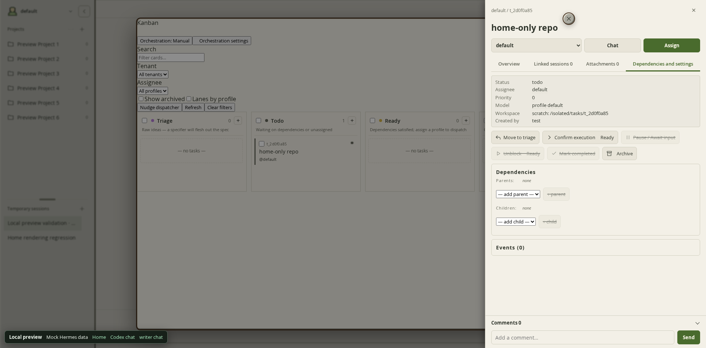
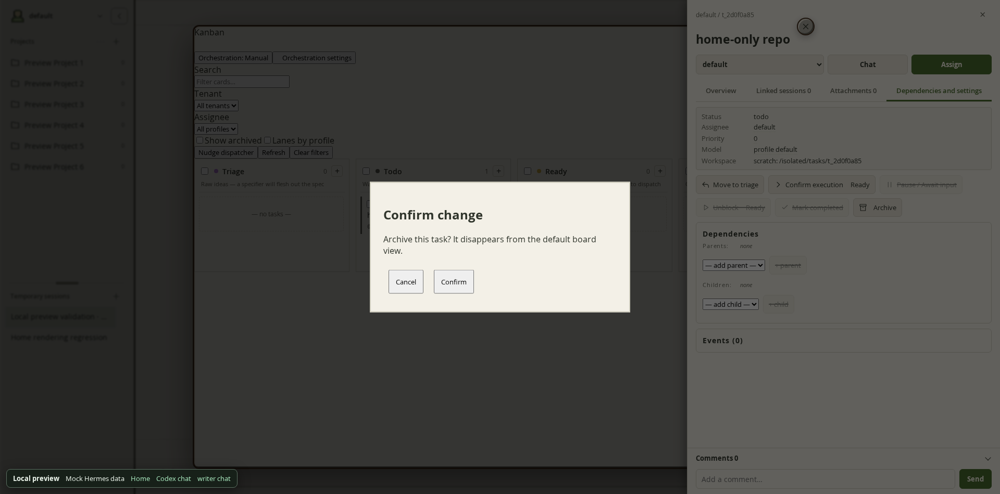
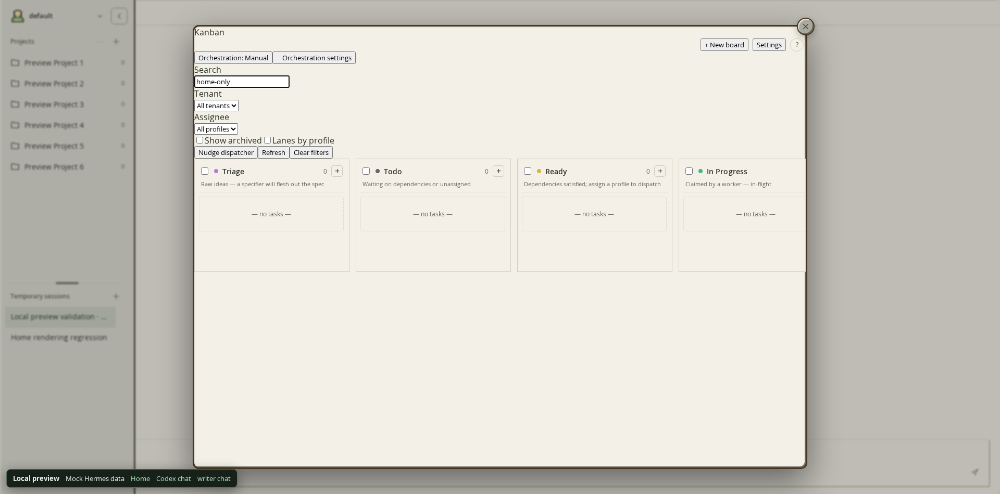
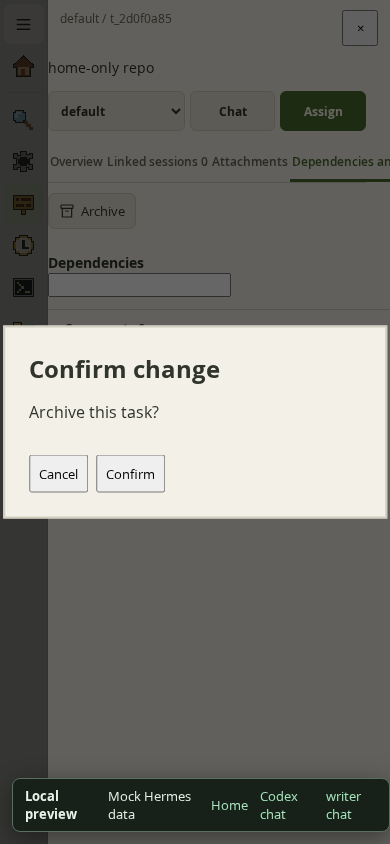

# Kanban drawer confirmation regression

## Reproduction and diagnosis

The supplied screenshot shows the default Kanban board, task `t_2d0f0a85`
(`home-only repo`), and the **Dependencies and settings** tab. The round × near
its title is the floating tool's `.dashboard-accessory-close`; the × at the
far right closes the task drawer. A still image cannot establish which action
was clicked. The reproduced trigger was **Archive** in that drawer. Block and
Complete use the same native confirmation component.

1. Open `/kanban?board=default&panel=1&profile=default`.
2. Open a task, then Dependencies and settings.
3. Click Archive.
4. Before the fix, the screen continues showing the drawer while the page
   appears unresponsive. The confirmation is present in the DOM but covered.

The host SDK `@nous-research/ui@0.18.2` ConfirmDialog portals two fixed siblings
to `document.body`: a backdrop and `role="alertdialog"`, both at `z-50`.
Workbench's floating board is at 82, its round close control at 86, and the
standalone native drawer at 110. Radix still sets body `pointer-events: none`
and traps focus in the invisible modal. The native `requestDialog` Promise
waits for confirmation; no Archive PATCH is sent yet. This is a layering and
modal interaction lock, not an event-loop deadlock or a hung backend request.

Notably, an ordinary Playwright click can reach the hidden confirmation through
the pointer-disabled foreground. The new regression test temporarily enables
hit testing on body children to assert the actual frontmost layer, then restores
those styles synchronously. It also checks that the event-loop heartbeat runs.

## Change

Raise only the host's body-level alertdialog and its fixed backdrop to 122/121
while a Kanban floating panel or task drawer is present. The backdrop is
identified by its fixed fullscreen classes and following alertdialog sibling
(the SDK does not give this backdrop a `data-slot`). Host callbacks, focus,
request ordering, cancellation, pointer-lock cleanup, and React ownership remain
intact. Unrelated tool dialogs retain the host's layer 50 after Kanban closes.

## Validation

All work and browser execution took place on W-nas in an isolated worktree.
The registered local branch was an old snapshot; testing and the fix use remote
main `fd4aefb2d4508a93a42cb1b9584da98e121fce05`, which contains the floating-panel
implementation shown in the screenshot. Production source and instances were
not changed. This is localhost validation with deterministic API responses,
not a claim of verification through the installed production loading route.

- Rebuilt the unchanged main CSS: the new browser regression fails because
  both content and backdrop are behind the board (`false` versus `true`).
- Rebuilt with the fix: floating desktop, standalone desktop and phone
  scenarios pass. Covers visible modal/backdrop, cancellation, Escape,
  repeated open/cancel, double confirmation with one PATCH, success, HTTP 503,
  editable input after each result, drawer close/reopen, floating tool close,
  restored navigation and an unaffected unrelated dialog.
- Separate native-component acceptance used the Hermes Kanban IIFE from the
  repository’s pinned compatibility layer (upstream base
  `a55c972e09177e4db3934915e329993858b247d6`; SHA-256 matches
  `integrations/hermes/manifest.json`:
  `a6902d29b9680c1d76238097b197af5d073b58259feec993fe09220e8d500c46`), the actual SDK
  ConfirmDialog/Button from `@nous-research/ui@0.18.2`, React/ReactDOM 19.2.7,
  the built Workbench bundle and a local host. The host supplied the SDK's
  Tailwind positioning utilities; API responses were mocked. Verified no PATCH
  before confirmation or on cancellation, repeated cancellation, one failing
  Archive PATCH (503), input interactivity and close/reopen, then one successful
  Archive PATCH on double confirmation. The task became archived; closing the
  floating panel restored editable chat and navigation. No page errors;
  the injected 503 was the expected network-console error.
- `npm run test:browser`: all eight browser scripts passed, including the new
  confirmation regression and the existing shell, attachments, cron, startup
  cache, message navigator, session rename and smart Kanban checks.
- `npm test`: 85 files, 416 tests passed.
- `npm run typecheck`: passed.
- `npm run build`: passed, including the loader and provenance generation.

The repeatable CI regression is included in `npm run test:browser`. To run just
this regression after building:

```sh
node tests/browser/kanban-confirmation.mjs
# Optional: use an installed browser and save screenshots.
CHROMIUM_EXECUTABLE_PATH=/path/to/chromium \
KANBAN_CONFIRMATION_SHOT_DIR=/tmp/kanban-confirmation \
node tests/browser/kanban-confirmation.mjs
```

The committed test models the SDK portal contract; the separate native-component
run checks the real SDK and native action callbacks. Neither uses production
credentials or dispatches workers.

## Visual evidence

Before: the native Archive confirmation exists but is hidden below the board.



After: the actual SDK confirmation is above the board and drawer.



After confirmation: the native Archive action completes.



The deterministic regression also checks the standalone phone layout.


