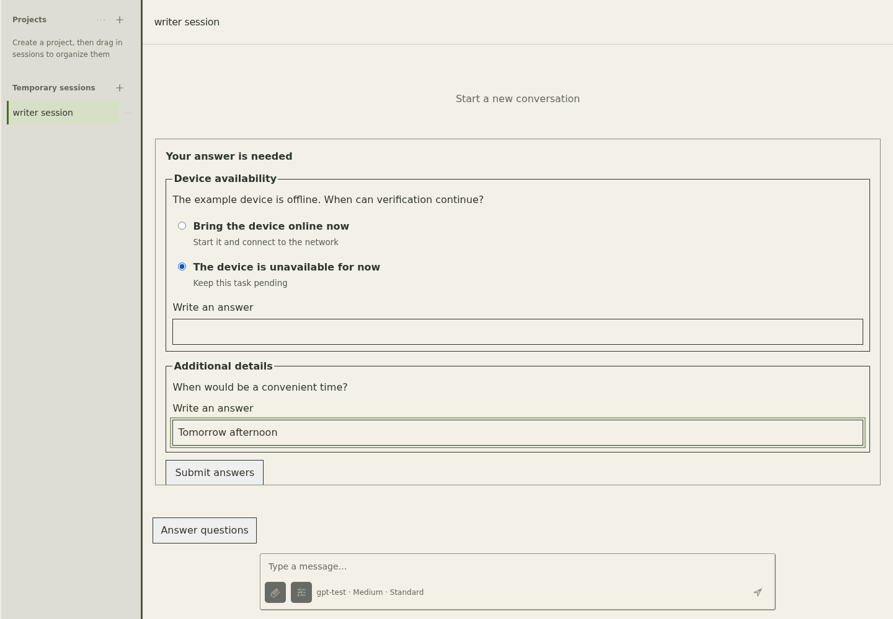
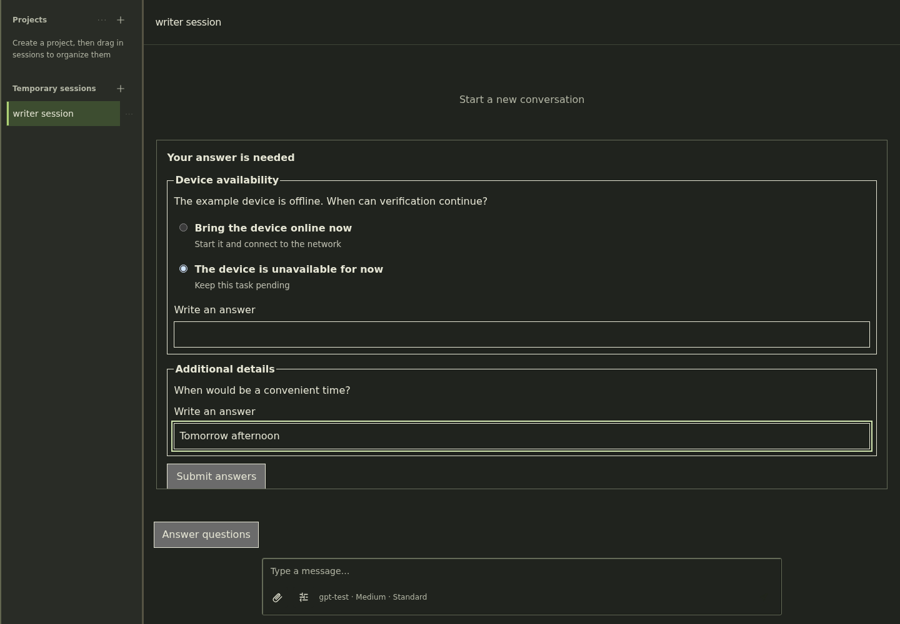

# Profile and Codex input validation

These screenshots use the English interface and fictional English-language
content on localhost. The test browser loads
installed `workbench.js` and `workbench.css` through the plugin thin loader;
API responses are mocked. Asset response MIME types and SHA-256 hashes were
checked against the installed files. This is not production-browser verification.

The question flow was checked at 1440 × 1000 and 390 × 844: selecting an option,
free-text answers, reload recovery, duplicate submission prevention, and uncertain
delivery. Async questions were checked with both idle and active turns, preserving
the normal composer draft. A separate browser check covered localized tab titles,
profile switching, three-pane limits, close/recreate drafts, and outgoing profile
model, reasoning, and service-priority values.

A separate live Codex app-server probe verified model, reasoning effort, and
service tier for newly created threads and completed turns. Thread reasoning uses
`config.model_reasoning_effort`; turn reasoning uses `effort`. Standard priority
sends `serviceTier: "default"` explicitly.

| Light | Dark |
| --- | --- |
|  |  |
