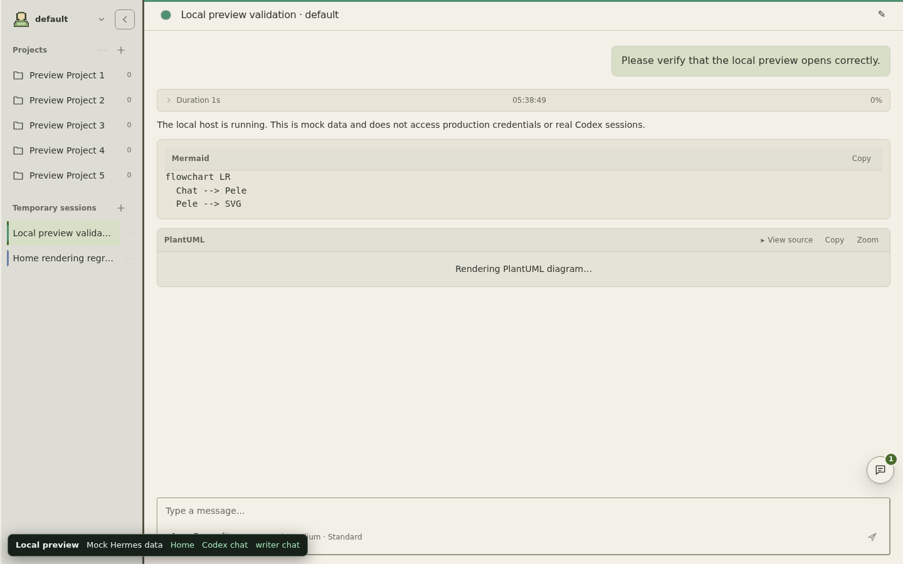
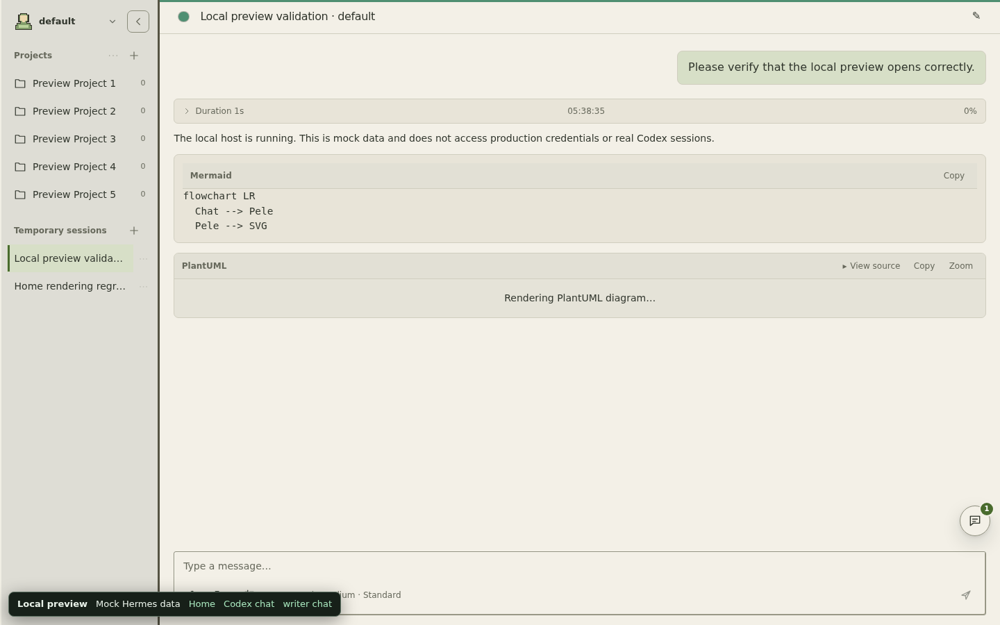
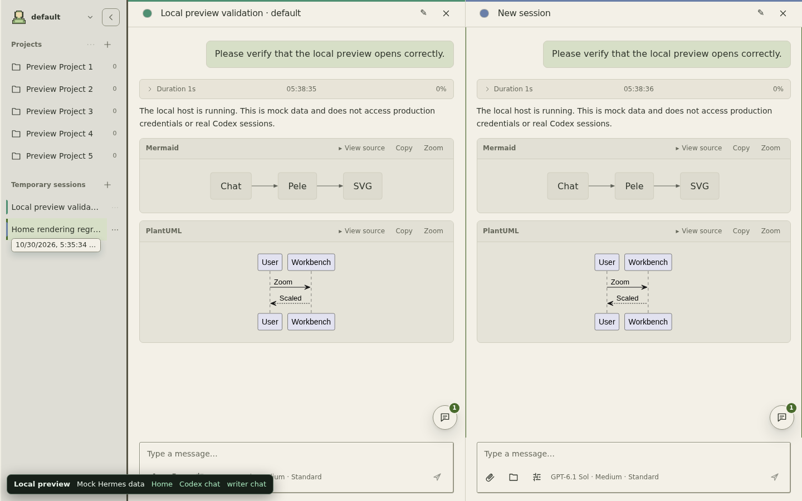
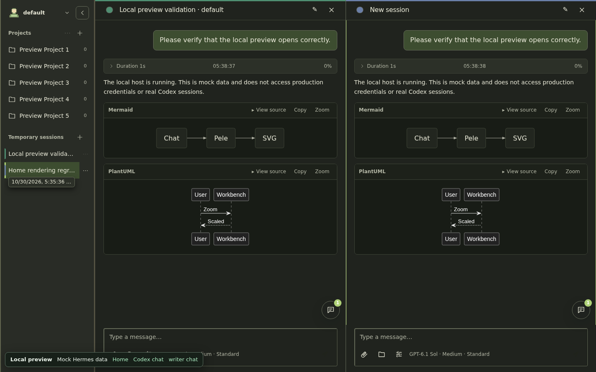
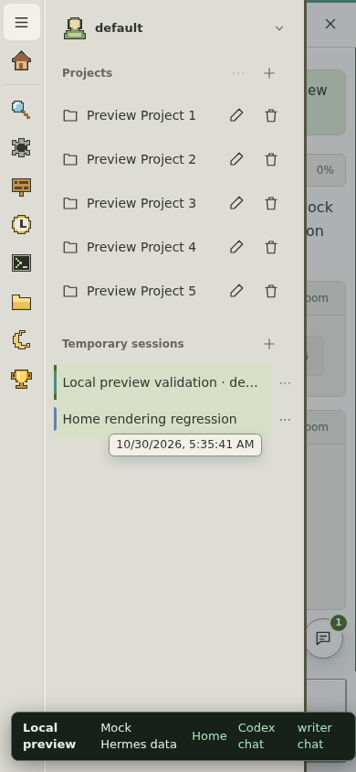
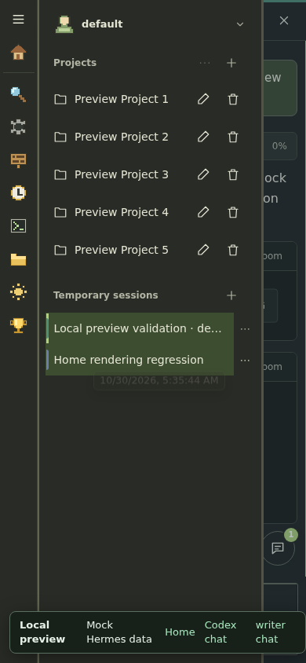

# Session color bars in split view

These screenshots use the built dashboard/dist/index.js in Chromium through the
local fixture host. All visible conversation text is fictional preview data; no
production or NAS state is read.

The session accent bar is a split-view locator. It appears only while two or
three panes are open, so the open session cards can be matched with the pane
headers. A single pane already marks its row as active and shows no bars.

| Before: a single pane colors every card | After: a single pane has no bars |
| --- | --- |
|  |  |

| Desktop light split | Desktop dark split |
| --- | --- |
|  |  |

| Mobile light split | Mobile dark split |
| --- | --- |
|  |  |

The before image was captured from origin/main at d0c656a; the after images came
from this branch with the same mock host and fixture data.
