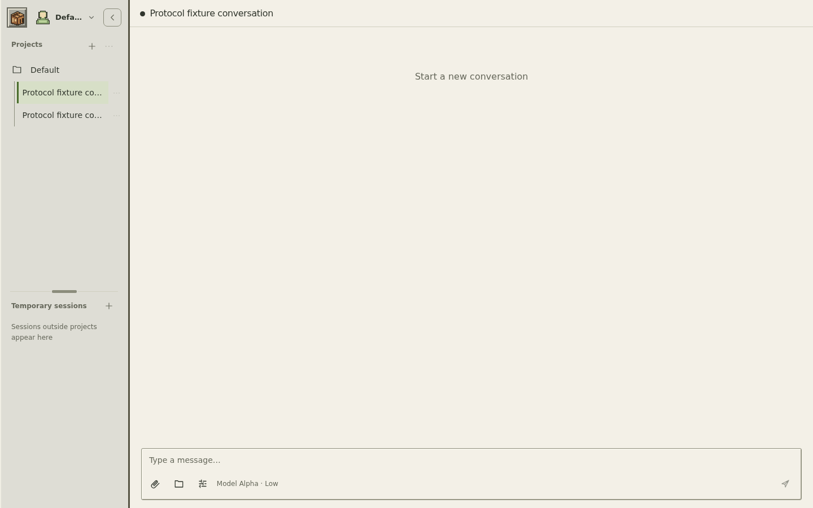
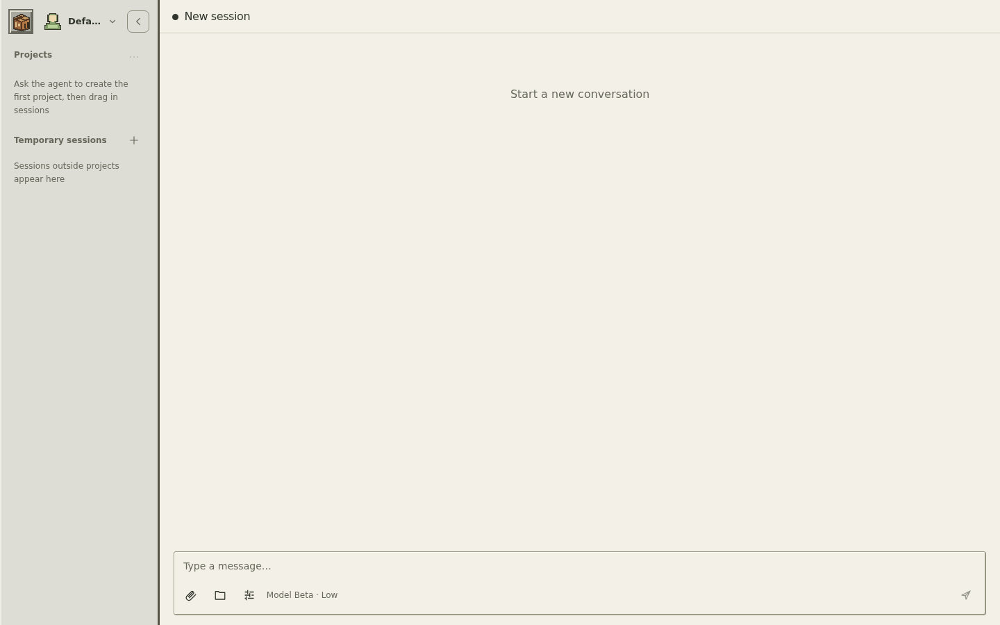
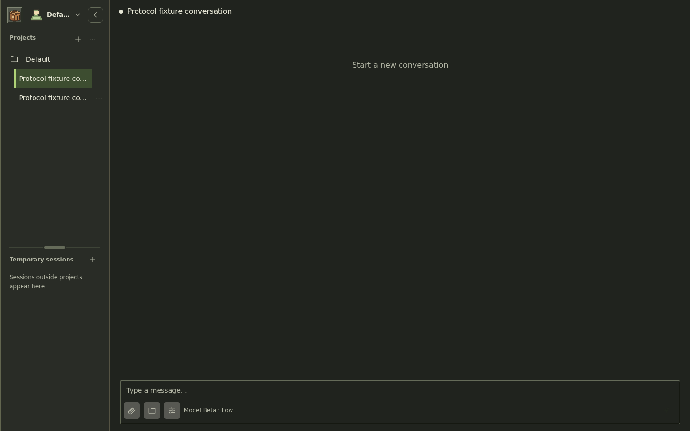
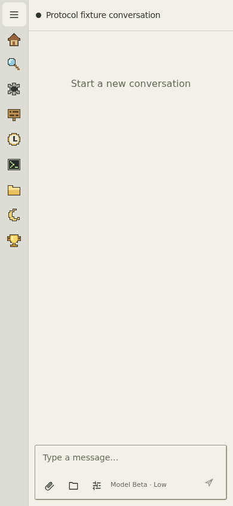
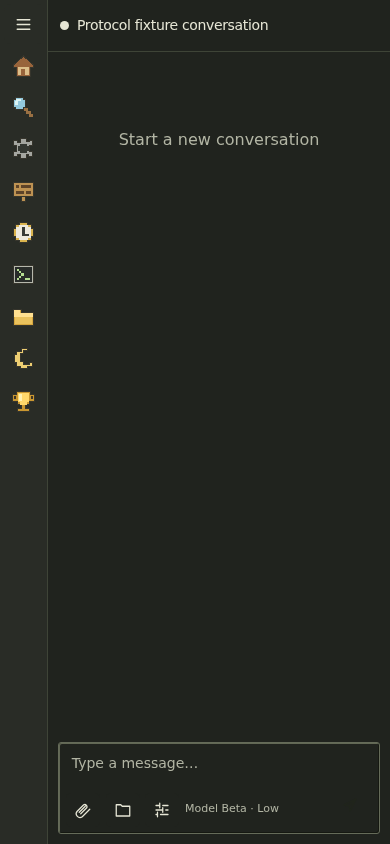

# Conversation model persistence

Before refresh, the previous chat UI kept a model choice only in component state.
Its standalone session observer also assigned the saved model to the workspace
selector, so opening the conversation restored the profile default instead.

| Before: unsent choice lost after refresh | After: server selection restored |
| --- | --- |
|  |  |

The chat now saves a deliberate selection immediately to the owned runtime
session. Each conversation and profile has separate optimistic state. Versioned
runtime events update another open browser, while a fresh browser restores the
same durable selection. Profile defaults apply when creating a new conversation.
Late snapshots, delayed catalog responses and old save acknowledgements cannot
replace a newer selection. A failed save keeps the chosen model visible, reports
the error and prevents sending with a fallback model.

## Validation

- Full frontend unit suite: 121 files, 642 tests passed.
- TypeScript source boundary and typecheck passed.
- Runtime contracts: 55 tests passed, including 9 creation/model tests and persisted model
  and revision after reopening the runtime store without sending a message.
- Standalone app and artifact contracts: 31 tests passed, including two independent
  authenticated clients, profile isolation and a changed profile default.
- Browser acceptance uses the actual standalone build, a real authenticated
  Workbench host and two independent browser contexts sharing one server.
  Its loopback runtime is an explicit neutral protocol fixture, not a provider
  connection. No inference calls or personal sessions are used.
- [Browser evidence](evidence.json) covers unsent selection, live peer updates,
  refresh, a fresh browser, different conversations, a late model catalog,
  late snapshots, rapid choices, failed saves and a draft's first message.
- [Baseline evidence](before-evidence.json) reproduces the refresh regression
  using the earlier chat implementation in the same isolated host.
- The standalone CI job runs the browser acceptance after building the app.

Run locally after `pnpm build:standalone`:

```sh
node tests/browser/session-model-sync.mjs
```

This change covers the standalone DSH chat path. The legacy plugin entry retains
its existing host contract. Deployment and release switching remain manual.

| Desktop dark | Mobile light | Mobile dark |
| --- | --- | --- |
|  |  |  |
